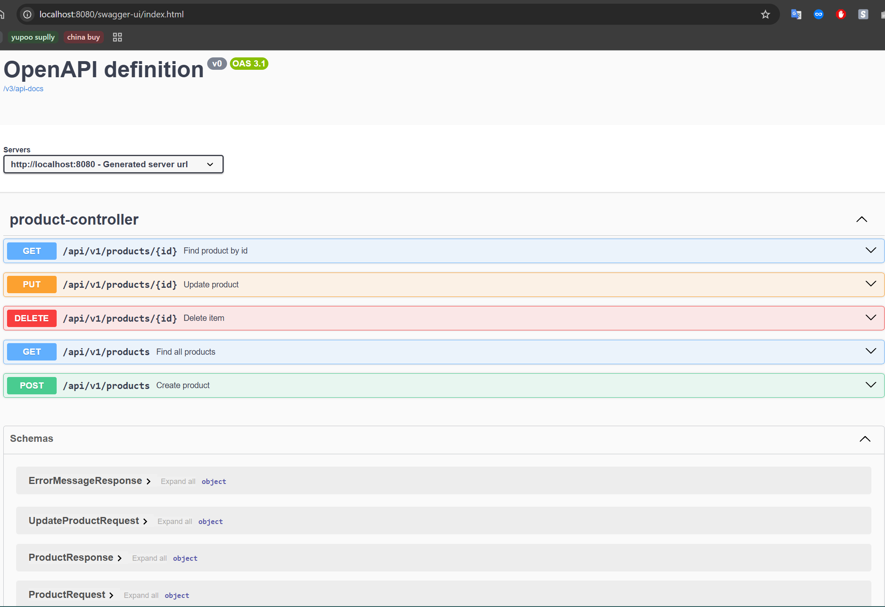
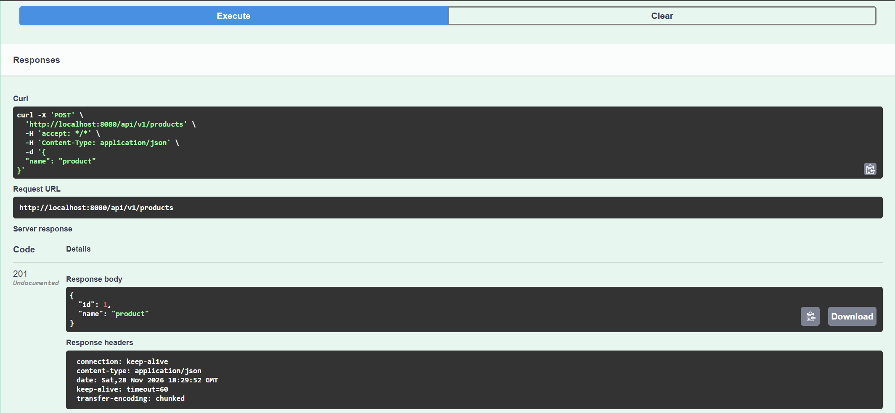
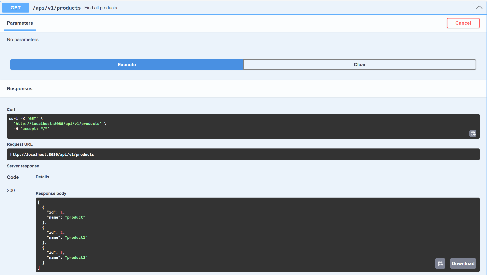
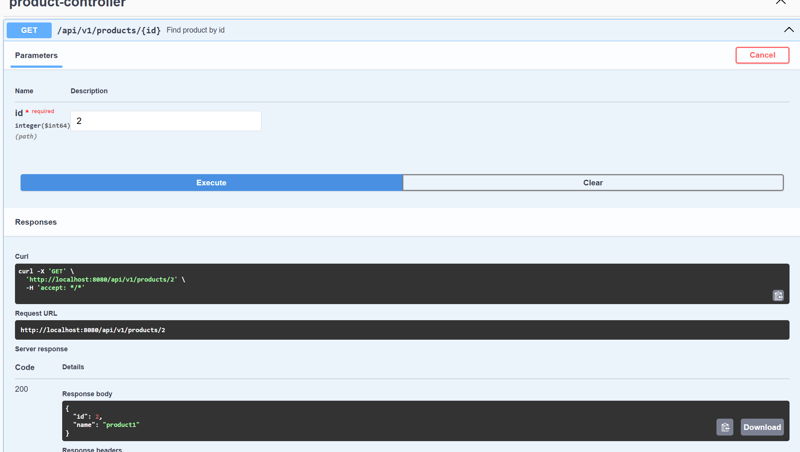
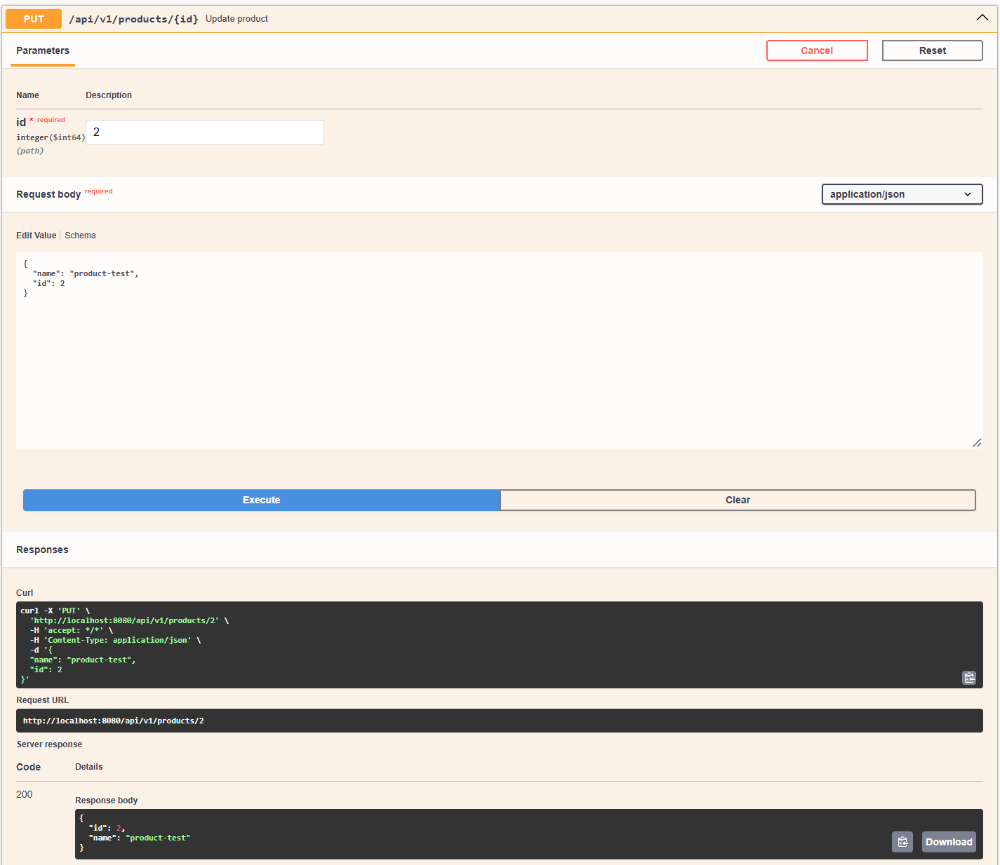
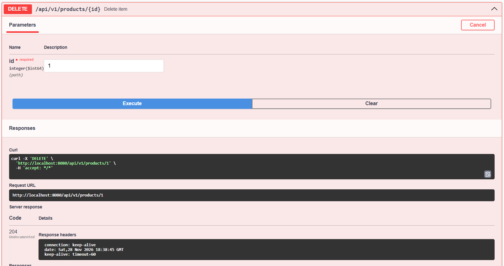
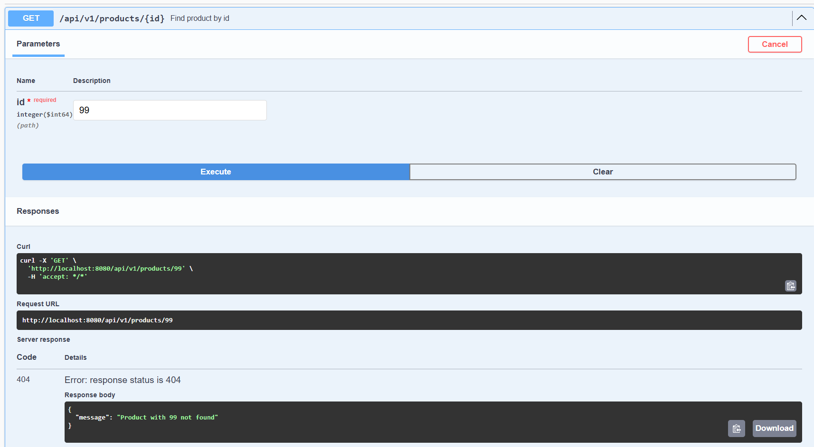
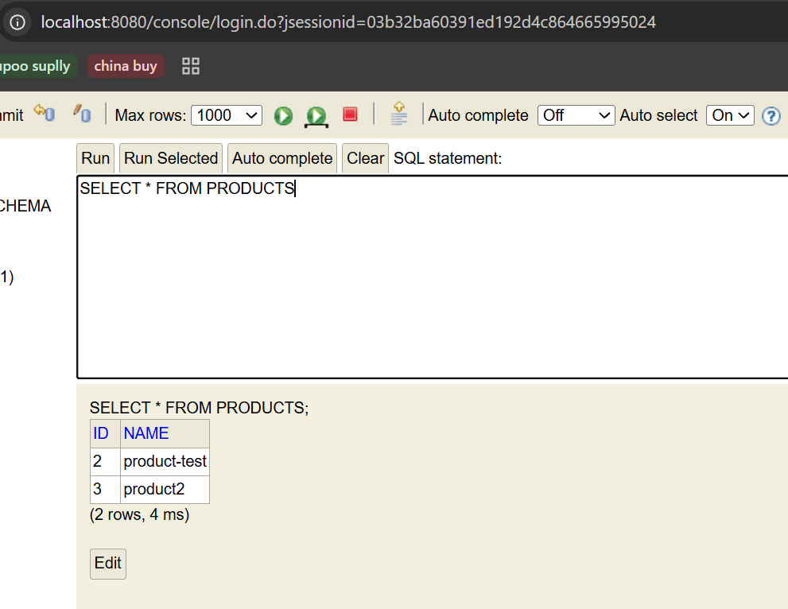
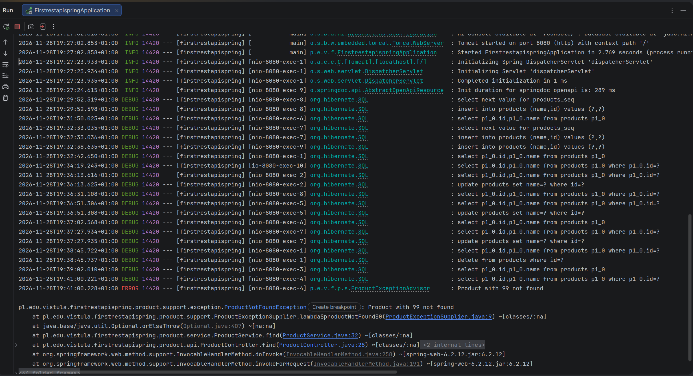

# Products REST API

A REST API for managing products, built with **Spring Boot**. It supports full CRUD
operations, error handling with proper HTTP status codes, API documentation with
**Swagger (OpenAPI)** and data storage in an **H2** in-memory database using
**Spring Data JPA**.

## Technologies
- Java 17
- Spring Boot 3 (Spring Web, Spring Data JPA)
- H2 Database (in-memory)
- springdoc-openapi (Swagger UI)
- Maven

## How to run
1. Open the project in IntelliJ IDEA.
2. Run `FirstrestapispringApplication`.
3. Open Swagger UI: `http://localhost:8080/swagger-ui/index.html`



## Endpoints

| Method | URL | Description | Success status |
|---|---|---|---|
| POST | `/api/v1/products` | Create a product | 201 Created |
| GET | `/api/v1/products` | Get all products | 200 OK |
| GET | `/api/v1/products/{id}` | Get a product by id | 200 OK |
| PUT | `/api/v1/products/{id}` | Update a product | 200 OK |
| DELETE | `/api/v1/products/{id}` | Delete a product | 204 No Content |

## Use cases

### 1. Create a product
**Request:** `POST /api/v1/products`
```json
{ "name": "First product" }
```
**Response:** `201 Created`
```json
{ "id": 1, "name": "First product" }
```


### 2. Get all products
**Request:** `GET /api/v1/products` returns a list of all saved products.



### 3. Get a product by id
**Request:** `GET /api/v1/products/1` returns one product.



### 4. Update a product
**Request:** `PUT /api/v1/products/1`
```json
{ "name": "Updated product", "id": 1 }
```
**Response:** `200 OK` with the updated product.



### 5. Delete a product
**Request:** `DELETE /api/v1/products/2`
**Response:** `204 No Content`



### 6. Handle a missing product
**Request:** `GET /api/v1/products/99`
**Response:** `404 Not Found`
```json
{ "message": "Product with 99 not found" }
```
When a product does not exist, `ProductService` throws `ProductNotFoundException`.
`ProductExceptionAdvisor` (`@ControllerAdvice`) catches it and returns status 404
with an error message.



### 7. Check the data in the H2 database
1. Open `http://localhost:8080/console`
2. JDBC URL: `jdbc:h2:mem:testdb`, user: `sa`, empty password, then **Connect**
3. Run `SELECT * FROM PRODUCTS`

The table shows the products after creating, updating and deleting them.



SQL queries generated by Hibernate are visible in the application log:



## Architecture
```
product
 ├─ api          ProductController (REST endpoints)
 │   ├─ request  ProductRequest, UpdateProductRequest
 │   └─ response ProductResponse
 ├─ domain       Product (JPA entity)
 ├─ repository   ProductRepository (JpaRepository), OldProductRepository (HashMap version)
 ├─ service      ProductService (business logic)
 └─ support      ProductMapper, ProductExceptionSupplier, ProductExceptionAdvisor
     └─ exception ProductNotFoundException
shared.api.response  ErrorMessageResponse
```
Requests go **Controller → Service → Repository → Database**. `ProductMapper` converts
between request/response objects and the `Product` entity.

## Configuration (`application.properties`)
```
spring.h2.console.enabled=true
spring.h2.console.path=/console/
spring.datasource.url=jdbc:h2:mem:testdb
logging.level.org.hibernate.SQL=DEBUG
```
